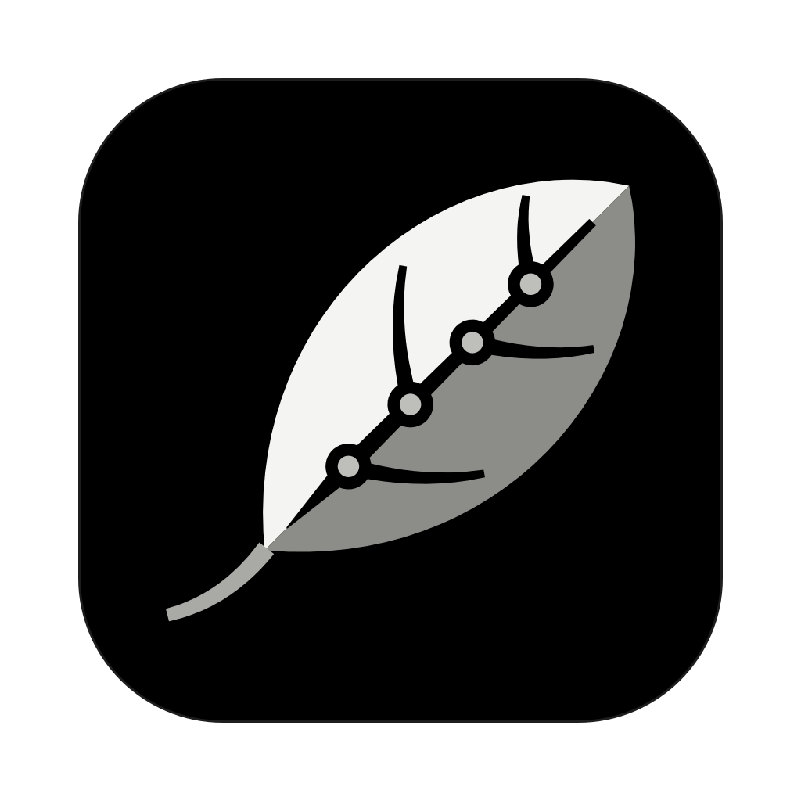

# Alessandro Schmidt

**Fullstack Software Engineer · Paris **

*"It is not the mountain we conquer, but ourselves."* 
- <a href="https://en.wikipedia.org/wiki/Edmund_Hillary" target="_blank" rel="noopener noreferrer">Edmund Hillary</a>

Java · Spring · React · Google Cloud · AI agents

&nbsp;

 
<!-- One icon per app, side by side, each linking to its repository. -->

